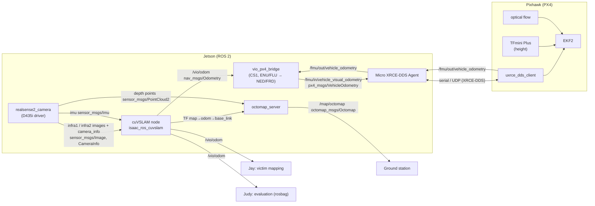

# CS1 ROS 2 pipeline: D435i → VIO → PX4 (for the system diagram)

Status: **proposal for Phase 1**, 8 Nov 2026. Topic names and message types were checked
against the sources in the last section (✔ = checked in the upstream docs or code;
◇ = our design choice, to confirm in SITL).

Onboard computer: Jetson (Orin). VIO on the Jetson is **Isaac ROS cuVSLAM**, not ORB-SLAM3:
published Jetson numbers put stock ORB-SLAM3 at 60–85 ms per frame, above our 38 ms budget,
while cuVSLAM tracks in a few ms (see `docs/jetson_latency_sources.md`). ORB-SLAM3 stays
as our offline accuracy baseline on EuRoC.

## Main chain (left to right in the diagram)

## Nodes and topics

### 1. `realsense2_camera` (D435i driver), package `realsense2_camera`

| Direction | Topic | Type | Notes |
|---|---|---|---|
| pub | `/camera/camera/infra1/image_rect_raw` | `sensor_msgs/Image` | left IR, mono8, global shutter ✔ |
| pub | `/camera/camera/infra1/camera_info` | `sensor_msgs/CameraInfo` | ✔ |
| pub | `/camera/camera/infra2/image_rect_raw` | `sensor_msgs/Image` | right IR ✔ |
| pub | `/camera/camera/infra2/camera_info` | `sensor_msgs/CameraInfo` | ✔ |
| pub | `/camera/camera/imu` | `sensor_msgs/Imu` | gyro + accel combined, at gyro rate, only when `unite_imu_method` > 0 ✔ |
| pub | `/camera/camera/depth/...` | `sensor_msgs/Image` / `PointCloud2` | only for OctoMap ◇ |
| pub | `/tf_static` | camera frames | `camera_link` origin = left IR camera ✔ |

- Topic prefix: realsense-ros 4.x defaults to `camera_namespace:=camera camera_name:=camera`,
  giving `/camera/camera/...` ✔. NVIDIA's cuVSLAM RealSense tutorial launch uses `/camera/...`
  (single level) ✔. Pick one in our launch file; the diagram does not change.
- Parameters: `enable_infra1:=true enable_infra2:=true enable_gyro:=true enable_accel:=true
  unite_imu_method:=2` (2 = accel interpolated to gyro timestamps ✔). Also, ◇:
  - IR projector off (`depth_module.emitter_enabled:=0`), because the dot pattern moves with
    the camera and confuses feature tracking.
  - If OctoMap needs depth, use the emitter on/off alternation instead.
- 640×480 at 30 FPS, as in Jeon et al. ✔ and NVIDIA's minimum ✔. Higher rates are listed under open questions.

### 2. cuVSLAM, package `isaac_ros_cuvslam` (renamed from `isaac_ros_visual_slam` on 2026-09-21 ✔)

| Direction | Topic | Type | Notes |
|---|---|---|---|
| sub | `visual_slam/image_0`, `visual_slam/image_1` | `sensor_msgs/Image` | remap from infra1 / infra2 ✔ |
| sub | `visual_slam/camera_info_0`, `_1` | `sensor_msgs/CameraInfo` | ✔ |
| sub | `visual_slam/imu` | `sensor_msgs/Imu` | only with `tracking_mode: 1` (visual-inertial) ✔ |
| pub | `visual_slam/tracking/odometry` → remap to **`/vio/odom`** | `nav_msgs/Odometry` | pose of `base_frame` ✔; remap ◇ |
| pub | `visual_slam/status` | `isaac_ros_visual_slam_interfaces/VisualSlamStatus` | tracking health, used for the tracking-loss fallback (Phase 3) ✔ |
| pub | `visual_slam/tracking/vo_pose_covariance` | `geometry_msgs/PoseWithCovarianceStamped` | ✔ |
| pub | TF `map → odom → base_link` | tf2 | `publish_map_to_odom_tf`, `publish_odom_to_base_tf` (default true) ✔ |

Parameters: `tracking_mode: 1`, `num_cameras: 2`, `rectified_images: true`, `map_frame: map`,
`odom_frame: odom`, `base_frame: base_link`, `imu_frame`, plus the IMU noise parameters
(`gyro_noise_density`, `accel_noise_density`, ...) from our own D435i IMU calibration ✔.
NVIDIA requires: ≥ 30 Hz images, ≤ ±2 ms frame jitter, ≤ 100 µs offset between the two
images of a stereo pair ✔.

### 3. `vio_px4_bridge` (CS1, to write), the only custom node on the chain

| Direction | Topic | Type | Notes |
|---|---|---|---|
| sub | `/vio/odom` | `nav_msgs/Odometry` | ENU world, FLU body (REP 103) |
| pub | `/fmu/in/vehicle_visual_odometry` | `px4_msgs/VehicleOdometry` | bridged by PX4 by default ✔ |
| sub | `/fmu/out/vehicle_odometry` | `px4_msgs/VehicleOdometry` | check EKF2 follows us; bridged at ≤ 100 Hz ✔ |
| sub | `visual_slam/status` | status | on tracking loss: stop publishing, so EKF2 falls back to flow + LiDAR ◇ |

What it does:
- **Frames.** It converts ENU→NED for position and FLU→FRD for the body:
  - position: (x, y, z)NED = (y, x, −z)ENU;
  - the quaternion is rotated the same way. Use `px4_ros_com`'s `frame_transforms` helpers rather than hand-written math ◇.
- **`pose_frame`.** Set it to `POSE_FRAME_FRD` (2): arbitrary heading, since we have no reliable compass indoors ✔.
  `velocity_frame` is FRD as well.
- **Timestamps.** `timestamp_sample` is the **image capture time** from `header.stamp`, not the send time.
  `timestamp` is the send time. Both are in µs ✔ (field definitions in `VehicleOdometry.msg`).
- **Variances.** `position_variance` and `orientation_variance` come from the odometry covariance.
- **Resets.** `reset_counter` is incremented whenever VIO resets or relocalises ✔.
- **Rate.** Publish at 30–50 Hz. PX4: "If the message rate is too low, EKF2 will not fuse the external vision messages" ✔.
- **Latency.** This node is the right place to measure the 38 ms budget: `now − header.stamp` at publish time.

### 4. Micro XRCE-DDS Agent (Jetson) ↔ `uxrce_dds_client` (PX4)

The agent bridges every `/fmu/in/*` and `/fmu/out/*` topic listed in PX4's `dds_topics.yaml` ✔.
The link to the Pixhawk is serial (TELEM port) or UDP.

### 5. PX4 / EKF2 (Pixhawk). Agree on these with Capybara (EE)

| Parameter | Setting | |
|---|---|---|
| `EKF2_EV_CTRL` | bitmask: bit 0 horizontal position, 1 vertical position, 2 3D velocity, 3 yaw. Start with 15 (all four) | ✔ bits, ◇ value |
| `EKF2_HGT_REF` | range finder (TFmini) or vision; decide in SITL. PX4 warns that both "should only be used when for operation over a flat surface" (rubble is not flat) | ✔ |
| `EKF2_EV_DELAY` | capture → PX4 delay in ms (0–300, default 0, reboot required); ~0 if `timestamp_sample` is right, then tune from logs | ✔ |
| `EKF2_EV_POS_X/Y/Z` | camera position in the body frame | ✔ |
| `EKF2_GPS_CTRL` | 0 (GPS off for the GPS-denied tests) | ✔ |
| `EKF2_RNG_CTRL`, `EKF2_OF_CTRL` | on: TFmini and optical flow plug into the Pixhawk directly | ✔ names |

### 6. Side branches

| Node | Owner | Subscribes | Publishes |
|---|---|---|---|
| victim localisation | Jay (CS2) | `/vio/odom`, TF `map → base_link` | victim positions in `map` |
| evaluation | Judy | `/vio/odom`, `/fmu/out/vehicle_odometry` (rosbag) | ATE / drift reports |
| `octomap_server` | CS1 | depth point cloud + TF | remap its output to **`/map/octomap`** (`octomap_msgs/Octomap`); check the exact output topic names of the version we install ◇ |
| map origin | CS1 | AprilTag at the entrance | static TF `map` origin ◇ |

## Open questions for SITL (Phase 1)

1. Which Jetson exactly (Orin Nano / NX / AGX)? Every latency number depends on it.
2. 30 vs 60 FPS: NVIDIA recommends 60 FPS on fast-moving platforms such as UAVs (cuVSLAM paper,
   App. A.2). The D435i IR stream at 60 FPS doubles the load; test both.
3. `EKF2_HGT_REF`: TFmini over rubble gives a jumpy "height" (PX4's own warning, see table). Vision or baro height may be steadier.

## Sources

- `isaac_ros_cuvslam` package docs: subscribed/published topics, parameters, renaming note.
  <https://nvidia-isaac-ros.github.io/repositories_and_packages/isaac_ros_visual_slam/isaac_ros_cuvslam/index.html>
- cuVSLAM RealSense tutorial (topic list).
  <https://nvidia-isaac-ros.github.io/concepts/visual_slam/cuvslam/tutorial_realsense.html>
- realsense-ros README (ros2-master): namespaces, `unite_imu_method`.
  <https://github.com/IntelRealSense/realsense-ros>
- PX4 `msg/versioned/VehicleOdometry.msg`, `src/modules/uxrce_dds_client/dds_topics.yaml`,
  `src/modules/ekf2/params_*.yaml` and `module.yaml` (branch main, read 8 Nov 2026).
- PX4 docs, "Using Vision or Motion Capture Systems for Position Estimation"
  (`docs/en/ros/external_position_estimation.md`): EKF2 parameters, 30–50 Hz rate, FRD frame.
- ROS REP 103 (ENU/FLU), REP 147 (aerial vehicles).
