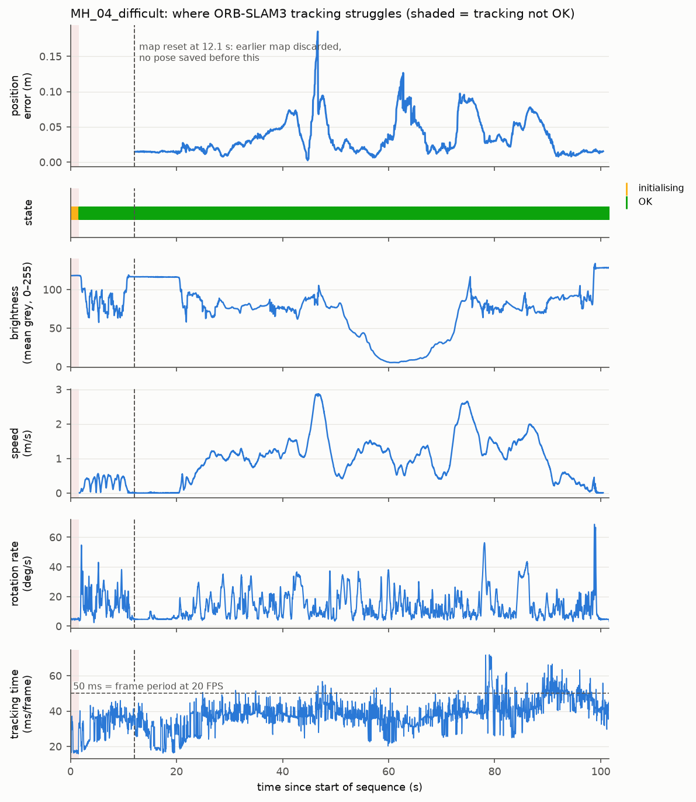

# CS1 Localization: Round 2 follow-up

**To:** Thu Hang · **From:** Kevin (CS1) · **Date:** 8 Nov 2026 (requested by Mon 9 Nov, 21:00)

You asked for four things. All four are done. The Round 2 results you already have are unchanged.

| # | Request | Answer in one line | Details |
|---|---|---|---|
| 1 | Published Jetson latency (most important) | Stock ORB-SLAM3 needs **60–85 ms/frame** on Jetson CPUs. cuVSLAM needs **3.8 ms** on AGX Orin. So 38 ms is realistic **with cuVSLAM**, not with ORB-SLAM3. | §1, `docs/jetson_latency_sources.md` |
| 2 | ROS 2 nodes/topics D435i → PX4 | 5 nodes on the main chain. Our only custom node is `vio_px4_bridge` (ENU→NED). A mermaid diagram is ready to redraw. | §2, `docs/ros2_interfaces.md` |
| 3 | MH_04_difficult (optional) | Tracking never got lost. The error is about **3× higher at fast motion** (> 2 m/s). Darkness had no consistent effect. The weak point is IMU start-up. | §3 |
| 4 | Drift without loop closure (optional) | **Loop closure never fired, even in Round 2.** The honest number is the on-line pose's drift over 30 m: **0.1–1.2 % mean, 2.1 % worst**. | §4 |

---

## 1. Published latency on Jetson: sources for the 38 ms target

| System | Board | Per-frame time | Source |
|---|---|---|---|
| ORB-SLAM3, stock (CPU) | Jetson Xavier NX | **84.6 ± 17.3 ms** (EuRoC MH01, stereo-inertial) | Khabiri et al., *IROS 2025* (peer-reviewed), Table III |
| ORB-SLAM3, stock (CPU) | Jetson Orin Nano | **62.1 ms** mean (all 11 EuRoC, stereo-inertial) | Roy et al., arXiv 2608.17874 (preprint, 2026), Table 8 |
| ORB-SLAM3, stereo (CPU) | Jetson Xavier | 60.3 ms mean, 71.6 ms max | Abi Hana et al., arXiv 2603.16240 (2026), Table 3 |
| cuVSLAM (GPU) | Jetson Xavier | **9.4 ms** mean, 40.3 ms max | same, Table 3 |
| cuVSLAM (GPU) | Jetson AGX Orin | **3.8 ms** mean (stereo-inertial) | Korovko et al. (NVIDIA), arXiv 2506.04359, Table 1 |
| *ours*: ORB-SLAM3 (CPU) | Xeon 8480+ server | 37.8 ms mean, 48.7 ms p95 | Round 2 |

**Suggested text for the plan:**

> Published benchmarks show that CPU-only ORB-SLAM3 needs 60–85 ms per frame on Jetson boards (Khabiri et al., IROS 2025;
> Roy et al., 2026), while NVIDIA's GPU-accelerated cuVSLAM tracks a stereo-inertial frame in 3.8 ms on Jetson AGX Orin
> (Korovko et al., 2025) and about 9 ms on the older Jetson Xavier (Abi Hana et al., 2026). We therefore run cuVSLAM on the
> drone and keep ORB-SLAM3 as an offline accuracy baseline. This leaves most of the 38 ms budget for image capture, transport
> and the PX4 interface, which we will measure end-to-end on our Jetson in Phase 1.

Points to know before the judges ask:
- **None of these sources reports p95 or end-to-end latency** (capture → PX4). They all time a single tracking call.
  Our own measurement on our Jetson in Phase 1 (task #10) is still needed.
- **Jeon et al. (RA-L 2021), the paper you suggested, does not report any latency or per-frame time.** It reports CPU/memory
  use and accuracy, for ORB-SLAM**2** on TX2/Xavier boards. It is still useful for one point: CPU-only stereo methods lost accuracy
  on weak Jetsons "owing to the limitation of per-frame processing time", and the authors recommend GPU-accelerated
  stereo VIO on the TX2.
- **Do not cite arXiv 2605.03678.** Its Jetson latency table (ORB-SLAM3 6.2 ms on Orin) contradicts its own limitations
  section, which says all experiments ran on an RTX 3090 server.
- Which Jetson we buy matters, and the sources do not cover every combination. There is no ORB-SLAM3 number on AGX Orin and
  no cuVSLAM stereo-inertial number on Orin Nano. Our own Phase-1 measurement settles it for our board.

Full table (10 data points), what each number measures, and complete references: `docs/jetson_latency_sources.md`.

## 2. ROS 2 nodes and topics, D435i → PX4

Main chain: `realsense2_camera` → `isaac_ros_cuvslam` → **`vio_px4_bridge`** (ours) → Micro XRCE-DDS Agent → PX4 `uxrce_dds_client` → EKF2.

| From → to | Topic | Message type |
|---|---|---|
| D435i driver → cuVSLAM | `/camera/camera/infra1/image_rect_raw`, `/camera/camera/infra2/image_rect_raw` (+ `camera_info`) | `sensor_msgs/Image`, `CameraInfo` |
| D435i driver → cuVSLAM | `/camera/camera/imu` (`unite_imu_method:=2`) | `sensor_msgs/Imu` |
| cuVSLAM → bridge, Jay, Judy | `/vio/odom` (remapped from `visual_slam/tracking/odometry`) | `nav_msgs/Odometry` (ENU / FLU) |
| cuVSLAM → all | TF `map → odom → base_link` | tf2 |
| bridge → PX4 | `/fmu/in/vehicle_visual_odometry` | `px4_msgs/VehicleOdometry` (NED / FRD) |
| PX4 → bridge | `/fmu/out/vehicle_odometry` | `px4_msgs/VehicleOdometry` |
| depth + TF → ground station | `/map/octomap` | `octomap_msgs/Octomap` |

The TFmini Plus and optical flow sensors plug into the Pixhawk, and EKF2 fuses them directly. Things the diagram should show,
all checked against PX4/NVIDIA sources:
- PX4 needs the odometry at **30–50 Hz**, or EKF2 will not fuse it.
- `pose_frame = FRD`, because we have no reliable compass indoors.
- `timestamp_sample` = image capture time.
- Relevant parameters: `EKF2_EV_CTRL` (bitmask, 15 = all), `EKF2_EV_DELAY`, `EKF2_GPS_CTRL = 0`.

`docs/ros2_interfaces.md` has a mermaid diagram you can redraw, every node's topics and parameters, and three open questions
for SITL.

## 3. MH_04_difficult: where tracking struggles

Same pipeline, default config, two runs:

| Run | ATE RMSE | RPE 1 m | Drift (Round 2 definition) | Coverage | ms/frame mean / p95 |
|---|---|---|---|---|---|
| run1 | 0.041 m | 0.031 m | 0.02 % | 90 % | 36.7 / 47.9 |
| run2 | 0.041 m | 0.030 m | 0.07 % | 90 % | 39.9 / 51.0 |

Findings for the risk section:
1. **Fast motion is the main error source.**
   - Above 2 m/s the mean position error is **0.091 m**, against 0.031 m below 2 m/s (about 3×, in both runs).
   - The worst error (0.18 m) is at the fastest moment, 2.9 m/s.
   - On a drone this means a speed limit matters more than the lighting.
2. **Darkness did not break tracking.**
   - The image gets very dark between 55 and 70 s (mean grey ≈ 5 of 255), yet tracking stayed OK in every frame.
   - In one run the error in dark frames was slightly higher (0.043 vs 0.034 m), in the other slightly lower, so there is no consistent effect.
   - Caveat: EuRoC "dark" is still a clean industrial hall. Dust, smoke and flickering light are not tested.
3. **Start-up is fragile.**
   - The drone stands still at the beginning, so IMU initialisation lacks motion. ORB-SLAM3 throws away its first map
     at 11–12 s, and **the first 11 s have no usable pose** (coverage 90 %).
   - The world frame is only final after "VIBA 2" at 36 s. Before that, the online pose jumps by up to 1.6 m on
     MH_04, and by up to 14 m on the other sequences. After it, no run shows a jump: the largest frame-to-frame step
     is 0.16 m, which is ordinary motion at 2.9 m/s.
   - **Implication for flights:** move/shake the drone before take-off and wait until VIO reports initialised before
     arming. PX4 must not trust the pose earlier.
4. **This CPU is not fast enough for real time here.** 7.6 % of frames (155 of 2032) took longer than the 50 ms frame period.
   This is another argument for cuVSLAM (§1).

## 4. Drift without loop closure

**Main finding: loop closure never ran.** None of the runs logged a single loop closure or map merge, with loop
closure on (`loopClosing: 1`, default) or off (`configs/EuRoC_noLC.yaml`, the only change). That includes the Round 2
runs you merged. So the 0.06 % / 0.04 % was not produced by loop closure. It came from two things:
- ORB-SLAM3 keeps re-matching its own map. EuRoC rooms are small and the drone keeps seeing the same walls.
- Round 2 scored the trajectory ORB-SLAM3 saves at the end. That trajectory is refined by later optimisation and was
  aligned to ground truth as a whole.

To get a number closer to what our 4.5 % target means, I logged the **online pose**: what `TrackStereo()` returns at each
frame, i.e. what the drone would send to PX4. It is scored from the moment IMU initialisation finishes. The main metric is
**drift over 30 m segments**: the translation error over every 30 m stretch of path, divided by 30 m. Our target is a 30 m loop.

| Sequence | Loop closure | ATE (m) | 10 m drift mean / max | **30 m drift mean / max** | Loops fired |
|---|---|---|---|---|---|
| MH_01_easy | off | 0.036 | 0.89 / 3.05 % | **0.47 / 1.28 %** | 0 |
| V1_01_easy | off | 0.022 | 0.35 / 1.13 % | **0.10 / 0.20 %** | 0 |
| MH_04_difficult | off | 0.053 | 2.23 / 3.80 % | **1.19 / 2.06 %** | 0 |
| (MH_04_difficult) | on (default) | 0.062 | 2.32 / 3.86 % | 1.24 / 2.13 % | 0 |

**Suggested text for the plan:**

> Scoring the on-line pose that would be sent to the flight controller (not the post-processed trajectory), drift over 30 m
> segments was 0.1–1.2 % on average and at most 2.1 % on the hardest sequence (MH_04_difficult, fast motion, dark section),
> below our 4.5 % target. Loop closure was not triggered in any run, so these figures do not depend on revisiting places.

Caveats:
- EuRoC is still kinder than a collapsed building. Even without loop closure, ORB-SLAM3 benefits from re-observing the same
  room. Our real 30 m flights (Phase 2, with Judy) are what counts, ideally on a path that does not double back.
- The "start-aligned" numbers in `results/extra/summary.md` align only the first 5 m of path, so a small heading error there
  grows with distance. Use them as a rough check. The 30 m segment drift needs no alignment and is the better figure.

Full tables, including the saved-trajectory numbers for comparison: `results/extra/summary.md`.

---

## What changed in the repo

- **New docs:** `docs/jetson_latency_sources.md` (§1) and `docs/ros2_interfaces.md` (§2).
- **New results:** `results/extra/`. MH_04 (run1, run2, struggle analysis), loop closure off, and online-pose drift
  for all three sequences.
- **New config:** `configs/EuRoC_noLC.yaml`, the default plus `loopClosing: 0`.
- **New scripts:** `eval/plot_struggle.py`, `eval/evaluate_online.py`, `eval/make_extra_summary.py`.
- **Logging-only additions to ORB-SLAM3** (no algorithm change):
  - the example now also saves the tracking state and the online pose per frame;
  - four existing log lines (VIBA 1/2, loop, merge) get a timestamp.

  A fresh install applies the same patches, and the result was checked byte-for-byte against the build used here.
- **`evaluate.py`** also reports start-aligned drift and coverage. Round 2 numbers are unchanged; re-evaluating gives identical results.
- **README:** a new "Round 2 follow-up" section with every command to rerun.
