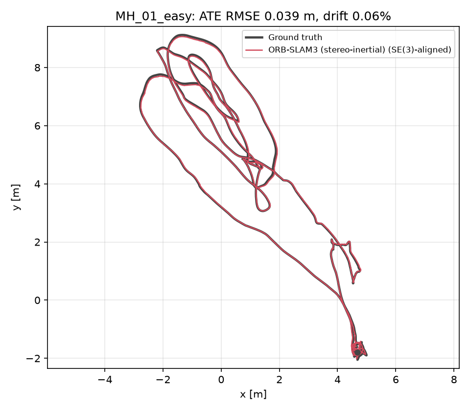
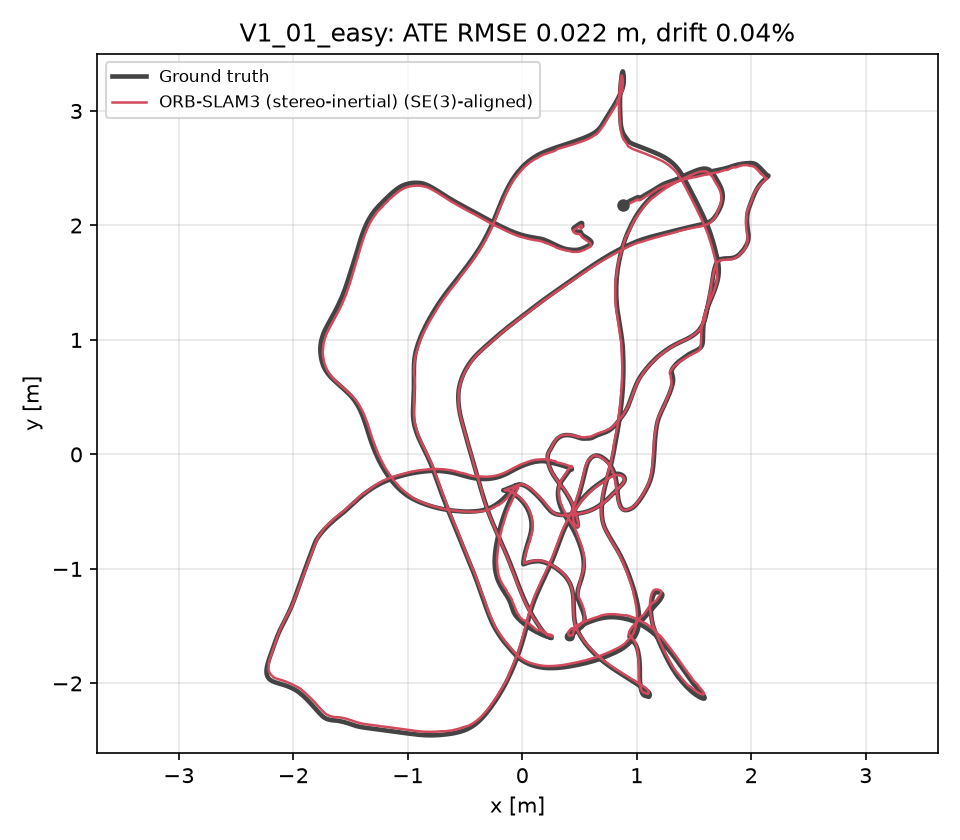

# CS1 Localization: Round 2 submission

**To:** Thu Hang (team lead) · **From:** Kevin (CS1) · **Date:** 4 Nov 2026 (deadline 12:00, Sun 8 Nov)
**cc:** Judy (evaluation), Jay (CS2)

## TL;DR

- VI-SLAM runs, and we can compute every metric we promised the judges.
- **ORB-SLAM3** (stereo + IMU, default config) ran on **EuRoC MH_01_easy and V1_01_easy** to the end with **no tracking loss**.
- **ATE 0.039 m / 0.022 m** (SE(3)-aligned), close to the numbers in the ORB-SLAM3 paper.
- A second run gives similar results, and rerunning the evaluation gives identical numbers.
- Everything is in the team repo, folder `localization/` of <https://github.com/wandering-pegasus/sar-drone>.

## 1. Results table (for the plan)

| Sequence | Algorithm | ATE RMSE (m) | RPE 1 m (m) | Trajectory length (m) | Drift (%) | Mean time/frame (ms) | p95 (ms) | Machine |
|---|---|---|---|---|---|---|---|---|
| MH_01_easy | ORB-SLAM3 stereo-inertial | 0.039 | 0.020 | 80.5 | 0.06 | 37.8 | 48.7 | Intel Xeon Platinum 8480+, 16 cores, no GPU |
| V1_01_easy | ORB-SLAM3 stereo-inertial | 0.022 | 0.014 | 58.3 | 0.04 | 37.1 | 47.7 | Intel Xeon Platinum 8480+, 16 cores, no GPU |

- ATE is the RMSE after SE(3) alignment (evo `-a`, no scale).
- RPE is the translation RMSE over 1 m segments.
- Drift is the final position error divided by the ground-truth path length.
- Time is the wall time of `TrackStereo()` per stereo frame.
- Algorithm: ORB-SLAM3 commit `4452a3c`, default `EuRoC.yaml`, no per-sequence tuning.

**Repeatability (run1 / run2):**

| Sequence | ATE (m) | Drift (%) | Mean (ms) | p95 (ms) |
|---|---|---|---|---|
| MH_01_easy | 0.039 / 0.047 | 0.06 / 0.08 | 37.8 / 31.4 | 48.7 / 43.3 |
| V1_01_easy | 0.022 / 0.022 | 0.04 / 0.03 | 37.1 / 29.9 | 47.7 / 40.5 |

## 2. Trajectory figures

Each figure shows the estimate (red) over the ground truth (grey), top view, in metres.





## 3. Paragraph for the plan (~150 words)

> To verify that the team can run VI-SLAM and compute the promised metrics, we evaluated ORB-SLAM3 (stereo-inertial, default configuration, commit 4452a3c) on two sequences of the public EuRoC MAV dataset (ETH Zürich): MH_01_easy (machine hall, 80.5 m) and V1_01_easy (Vicon room, 58.3 m), using the provided motion-capture ground truth. After SE(3) alignment, the absolute trajectory error (ATE RMSE) was 0.039 m and 0.022 m, the relative pose error over 1 m segments was 0.020 m and 0.014 m, and the final drift was 0.06 % and 0.04 % of distance travelled (project target: ≤ 4.5 % on a 30 m loop). Both sequences ran to the end without tracking loss, and a second run gave similar results. Tracking took about 37 ms per frame on average (p95 about 48 ms) on one Intel Xeon Platinum 8480+ (16 cores, no GPU). These figures are our EuRoC baseline. Limitation: EuRoC is a well-lit indoor scene with loop closures, and timing was measured on a server CPU, not the Jetson; dark, dusty tunnels and end-to-end latency to PX4 remain to be tested in Phases 1–3.

A Traditional Chinese version is in `results/writeup.md`.

## 4. Please read before merging into the plan

1. **Drift 0.06 % should not be compared directly with the 4.5 % target.** It is measured after aligning the whole trajectory, and EuRoC has loop closures. The 4.5 % target is for a 30 m closed loop on our real drone (Phase 2). Present the EuRoC numbers as our *baseline*, not as proof that we meet the target.
2. **Timing is not the 38 ms latency target.** It is tracking time per frame on a server CPU. It is not end-to-end capture → PX4, and it was not measured on the Jetson; that is checked in Phase 1. The p95 of about 48 ms on this CPU means the Jetson latency needs attention early.
3. **V1_01_easy ground truth.** As the OpenVINS docs warn, the original EuRoC ground truth for V1_01 has a bad orientation estimate. We use the OpenVINS-corrected ground truth. With the original one, ATE is 0.038 m and the rotation error is 5.5°; with the corrected one, the rotation error is 0.43°.
4. **ROS 2 was not used.** Our compute server has no root access, so ROS 2 could not be installed there. As the task sheet allows, we switched to ORB-SLAM3, which runs without ROS. Because of this, the RViz screenshot (task 1) is replaced by the trajectory figures. ROS 2 is set up in Phase 1, together with PX4 SITL.

## 5. Self-check (Round 2 items)

| # | Task | Status | Evidence |
|---|---|---|---|
| 1 | Set up the environment | Done (ORB-SLAM3 instead of ROS 2, see 4.4) | Install steps in README; fresh install tested from scratch |
| 2 | Run 2 EuRoC sequences | Done; no tracking loss (1 map each) | `results/<seq>/est.tum` |
| 3 | ATE and RPE | Done; rerun gives identical numbers | `ate.zip`, `rpe.txt`, `traj.png` |
| 4 | Drift % | Done | Table above |
| 5 | Processing time | Done, machine stated | Table above, `runs/<seq>/<run>/machine.txt` |
| 6 | Write for the plan | Done, waiting for your review | Section 3 |
| 7 | Push to the repo | Done (9 Nov): `localization/` in the team repo | <https://github.com/wandering-pegasus/sar-drone/tree/main/localization> |

## 6. Reproducing

Everything is in the `cs1-localization` repo. In short:

```bash
bash scripts/setup_orbslam3_conda.sh ~/slam      # no-root install (~15 min); Ubuntu+sudo: setup_orbslam3.sh
source ~/slam/activate.sh
bash scripts/download_euroc.sh ~/datasets/euroc  # CRC-checked mirror (old ETH server is offline)
export EUROC_DIR=~/datasets/euroc
bash scripts/run_all.sh run1                     # runs + evaluates both sequences -> results/
```

Notes:
- The old ETH download server is offline. Data now comes from a Hugging Face mirror of the original ASL zips, with the CRC and frame counts checked. V1_01 was also cross-checked against a second mirror, and the two copies are identical.
- Details, metric definitions and troubleshooting are in `README.md`.

**Files in `results/`:** `MH_01_easy/` and `V1_01_easy/` (`est.tum`, `ate.zip`, `rpe.txt`, `traj.png`, `metrics.json`), `summary.md`, `writeup.md`, and this report.
