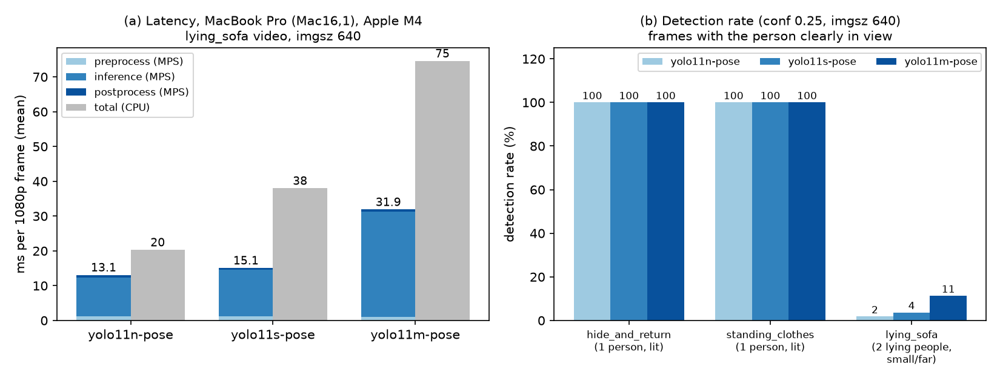

# Victim detection - Round 2 results (Jay)

We ran the pretrained yolo11n/s/m-pose models (default settings: conf 0.25, 640 px) on three phone videos on a MacBook Pro (Mac16,1, Apple M4) using the Apple GPU (MPS). A person standing in a lit room is found in 100% of frames by all three models, and latency grows with model size: 13.1, 15.1 and 31.9 ms per frame, faster than CPU (20, 38, 75 ms). The hard case: two small, distant people lying on sofas, partly behind furniture. There the models find only 1.8%, 3.7% and 11.3% of person-frames (n, s, m); a 1280 px input raises this to 32%, 46% and 50%. On our RTX 3050 6GB Laptop GPU, fine-tuning yolo11m-pose runs out of memory at the default batch size of 16 and only fits at batch 8 (vram.csv); as m-pose also finds lying people about three times as often as s-pose (11% vs 4%), Phase 1 fine-tuning is planned on the team workstation. Limitation: no dark-scene test yet.

*Figure 1. (a) Latency per frame on the MacBook Pro (Mac16,1), Apple M4, macOS 27.2, Ultralytics 8.4.204 - MPS vs CPU. (b) Detection rate per model and video (conf 0.25, 640 px). Details: `detection_test.md`.*

**Table 1 - Detection rate** (frames where the person is clearly in view; lying_sofa: person-instances; run on the MacBook Pro M4 with MPS)

| Video | Frames | yolo11n-pose (%) | yolo11s-pose (%) | yolo11m-pose (%) | Where it fails |
|---|---|---|---|---|---|
| hide_and_return (1 person, lit room) | 1648 | 100.0 | 100.0 | 100.0 | person half behind a wall: 64.8 / 68.5 / 74.2 % found |
| standing_clothes (1 person, lit room) | 245 | 100.0 | 100.0 | 100.0 | person at the image edge: 70.2 / 76.0 / 77.9 % found |
| lying_sofa (2 people lying, small, partly covered) | 891 | 1.8 | 3.7 | 11.3 | right-sofa person almost never found; left-sofa person 2.9 / 6.5 / 19.8 % |

**Table 2 - Latency per frame** (lying_sofa video, 1080p input, imgsz 640, device mps; MacBook Pro Mac16,1, Apple M4, 16 GB, macOS 27.2, Ultralytics 8.4.204, torch 2.15.0; mean of 812 frames after 10 warm-up frames)

| Model | Preprocess (ms) | Inference mean (ms) | Inference p95 (ms) | Postprocess (ms) | Total mean (ms) | Same model on CPU, total (ms) |
|---|---|---|---|---|---|---|
| yolo11n-pose | 1.2 | 11.2 | 13.3 | 0.6 | 13.1 | 20.3 |
| yolo11s-pose | 1.2 | 13.3 | 13.9 | 0.6 | 15.1 | 38.0 |
| yolo11m-pose | 1.1 | 30.1 | 30.5 | 0.7 | 31.9 | 74.6 |

*VRAM (measured by Thu Hang on the RTX 3050 6GB Laptop GPU, `vram.csv`, 1-epoch training on tiger-pose at 640 px): yolo11n-pose batch 16 peak 2,706 MiB; yolo11s-pose batch 16 peak 4,340 MiB; yolo11m-pose out of memory at batch 16, trains at batch 8 with peak 4,506 MiB.*
